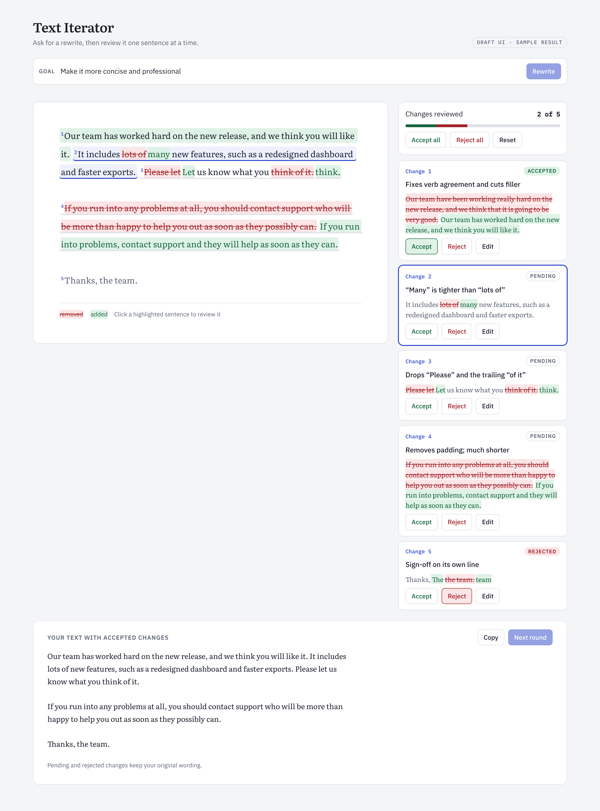

# text_diff

Turn an LLM rewrite into reviewable, sentence-sized change blocks.

Ask a model to improve some text and you usually get a whole new version back, with no
easy way to see what changed or keep only the good parts. `text_diff` diffs the rewrite
against the original and groups the edits into blocks, one per sentence (or clause). You
then accept, reject or tweak each block, and can optionally see a short reason for it.

The data shapes and calls a UI can rely on are in [INTERFACE.md](INTERFACE.md).



## Install

``` sh
pip install git+https://github.com/hugobellamy/text_diff.git
```

## Blocks from two texts (no LLM)

``` python
from text_diff.blocks import compute_blocks, set_status, blocks_to_text

blocks = compute_blocks(
    "The cat sat on the mat. It was very very happy.",
    "The cat lay on the rug. It was very happy.",
)
for b in blocks:
    if b["type"] == "change":
        print(b["id"], b["old_text"], "->", b["new_text"])
```

    0 The cat sat on the mat. -> The cat lay on the rug.
    2 It was very very happy. -> It was very happy.

``` python
blocks = set_status(blocks, "0", "accepted")
blocks_to_text(blocks)
```

    'The cat lay on the rug. It was very very happy.'

## Rewrite with an LLM

Requires an [OpenRouter](https://openrouter.ai/) API key, passed as `api_key` or set as
`OPENROUTER_API_KEY`.

``` python
from text_diff.blocks import improve_text

blocks = await improve_text(
    "The cat sat on the mat and looked around the room slowly.",
    goal="make it more concise",
)
```

Each change block comes back with a `comment` explaining the edit. Pass `comments=False`
to skip that extra call, or `granularity="clause"` for smaller blocks.

## Development

``` sh
pip install -e ".[dev]"
pytest
```
